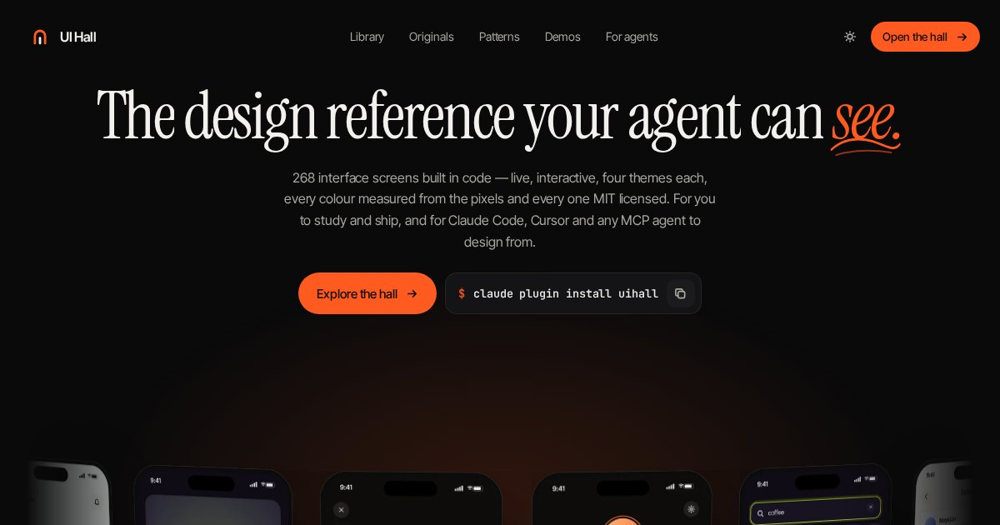

<div align="center">

# UI Hall

**Design evidence for humans and agents.**

404 live interface screens built in code — four themes each, written up and colour-measured, all MIT licensed —
as a website, an MCP server and an agent skill.

[**Open the hall →**](https://nikithamal.github.io/UiHall/) · [For agents](https://nikithamal.github.io/UiHall/#/agents) · [Playground](https://nikithamal.github.io/UiHall/#/agents?tab=playground)



</div>

---

Ask a coding agent for "a finance app" and you get a blue gradient, a card and a rounded button — the average of
everything it has seen. UI Hall replaces the average with real, live, *described* screens it can search, open and
adapt — every one MIT licensed.

| | What it is |
|---|---|
| **The hall** (repo root) | A browsable library: ranked search, facets by role/style/surface/colour, a colour search in OKLab, a pattern library, a motion reel and a detail view that turns any palette into code tokens. |
| **The MCP server** (`mcp/`) | `uihall-mcp` — 13 design tools for Claude Code, Cursor, VS Code, Codex, Claude Desktop or anything that speaks MCP. One file, zero dependencies, no API key. |
| **The skill** (`skills/uihall/`) | Tells the agent *when* and *how* to use the corpus: brief → look → steal structure → measured colour → checklist. Works with or without MCP (bundled CLI). |
| **The plugin** (`plugin/`) | Skill + MCP in one Claude Code install. |
| **The showcase** (`demo/`) | [Four working prototypes](https://nikithamal.github.io/UiHall/#/demos) built by following the skill end to end — Halo (dark wallet), Relay (pricing page), Kiln (analytics dashboard), Hush (onboarding) — each citing its references and measured palette. |

## Install

**Claude Code — plugin (skill + MCP, recommended)**

```bash
claude plugin marketplace add https://nikithamal.github.io/UiHall/.claude-plugin/marketplace.json
claude plugin install uihall@uihall
```

The plugin source is a `git-subdir`, so Claude Code fetches only `plugin/` — not the image corpus.

**Any MCP client — the single-file server**

```bash
curl -fsSL https://nikithamal.github.io/UiHall/mcp/dist/uihall-mcp.mjs -o ~/.uihall-mcp.mjs

claude mcp add uihall --scope user -- node ~/.uihall-mcp.mjs     # Claude Code
codex mcp add uihall -- node ~/.uihall-mcp.mjs                   # Codex CLI
```

Cursor (`~/.cursor/mcp.json`) / VS Code (`.vscode/mcp.json`, use `"servers"` and `"type": "stdio"`):

```json
{ "mcpServers": { "uihall": { "command": "node", "args": ["${userHome}/.uihall-mcp.mjs"] } } }
```

Hosted / URL-based clients: `node ~/.uihall-mcp.mjs --http 8787` → `http://127.0.0.1:8787/mcp` (Streamable HTTP).

**The skill on its own**

```bash
mkdir -p ~/.claude/skills && curl -fsSL https://nikithamal.github.io/UiHall/skills/uihall.tar.gz | tar -xz -C ~/.claude/skills
```

Needs Node 18+. On first run the server downloads the corpus (~1.3 MB) from the site and caches it in
`~/.cache/uihall`; images are fetched only when an agent asks to see one. Set `UIHALL_ROOT=/path/to/UiHall`
to run fully offline from a checkout.

## The tools

| Tool | Answers |
|---|---|
| `design_brief` | "I'm building X" → closest references, patterns with build rules, three palettes from real references split into UI roles with WCAG checks, do/avoid guidance, a done-checklist |
| `search_designs` | Ranked BM25 search with design synonyms ("fintech" ⇒ wallet, banking…) and facet filters; `include_images` attaches thumbnails |
| `view_design` | The rendered screen, in any of its four themes, so the model sees proportion and polish |
| `get_design` | Full write-up, measured palette with area %, colour roles, contrast, printed swatch names, URLs |
| `find_similar` | Neighbours by content, by measured colour, or both |
| `find_patterns` | 21 structural patterns, each with why, build rules and evidence ids |
| `palette_for` | Real palettes for a mood or product, never invented |
| `search_by_color` | Who actually uses this colour (OKLab ΔE over measured swatches) |
| `export_tokens` | Palette → CSS variables, Tailwind, W3C design tokens, SwiftUI or Jetpack Compose (11-step accent + neutral ramps) |
| `compare_designs` | 2–4 references side by side: shared vs distinct traits, colour roles, palette distance |
| `generate_design_system` | A paste-ready starter system — colour + ramps, type pairing and scale, radius, motion, base components |
| `check_contrast` | WCAG ratio + verdict + the nearest passing colour |
| `corpus_overview` | The exact vocabulary for filters, counts, patterns and provenance |

Plus resources (`uihall://overview`, `uihall://patterns`, `uihall://design/{id}`, `uihall://image/{id}`) and prompts
(`/design-screen`, `/critique-ui`, `/pick-palette`). Protocol 2025-06-18 with negotiation down to 2024-11-05; every
tool is annotated read-only and returns compact markdown for the model plus `structuredContent` for code.

No MCP? The skill's CLI runs the same tools: `node skills/uihall/scripts/uihall.mjs brief "pricing page for a dev tool" --platform web`.

## How the hall is made

| Claim | How |
|---|---|
| **Original** — every screen | Designed and built in code for UI Hall from one shared kit (`originals/kit`), rendered in four themes (Ember, Mint, Ink, Grape), MIT licensed. 44 are hand-built; 360 are composed by `originals/src/gen.py` across 20 product domains × 18 screen types. |
| **Observed** — descriptions | Generated from the exact content each screen renders, so a write-up cannot drift from its pixels. |
| **Measured** — palettes | k-means over each rendered theme with area percentages; split into background / surface / text / accent roles and contrast-checked at query time. |
| **Live** — interaction | Every screen opens as real HTML: toggles, chips, steppers, tabs and fields work, and the palette switches in place. |

The hall previously also held ~730 collected third-party references; they were replaced by originals in October 2026 and remain only in git history.

## Repository

```
index.html               the site (vanilla ES modules, no build step) — served at the Pages root
assets/css/site.css      design tokens → primitives → views, one layered file
assets/js/               main (router), lib (DOM + motion), cmdk, board, views/*
assets/{img,thumb}/      the rendered originals (one file per theme)
data/corpus.json         the single source of truth
demo/                    prototypes built with the skill
mcp/                     uihall-mcp
  src/engine.js          isomorphic engine — the site imports this same file
  src/{color,patterns,tools,corpus,server,cli}.js
  dist/uihall-mcp.mjs    single-file build (what people install)
  test/selftest.mjs      30 protocol-level assertions
skills/uihall/           the skill (SKILL.md, references/, scripts/uihall.mjs)
plugin/                  Claude Code plugin (built)
.claude-plugin/          plugin marketplace manifest
tools/                   corpus pipeline (Python) + release build + local server
_work/                   pipeline intermediates
```

### Develop

```bash
node tools/serve.mjs 8099            # → http://127.0.0.1:8099/
node tools/build_release.mjs         # bundle server + CLI, regenerate skill refs, pack plugin + tarball, selftest
node mcp/test/selftest.mjs           # test the server from source
```

The site runs the real MCP tool handlers in the browser (`#/agents?tab=playground`), so what you see there is
exactly what an agent gets.

## Provenance

Collected from public sources for study. Interfaces belong to the people who designed them; nothing here is
licensed for redistribution. Use it to learn the vocabulary of interface design — hierarchy, rhythm, colour
logic — not to ship a clone of a specific product. Code (site, server, skill) is MIT.
