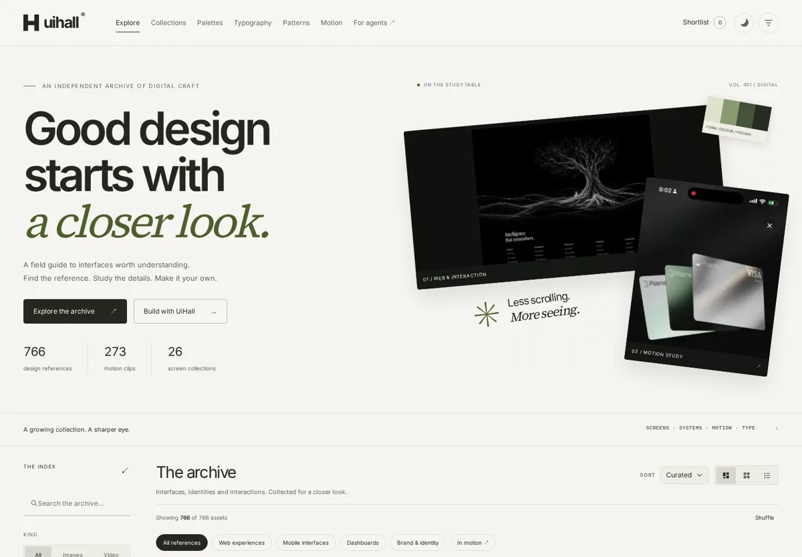

# UiHall

**A field guide to digital craft — for people and their agents.**

UiHall connects a browsable design archive, a local MCP server and an evidence-driven
design skill. Find references, inspect the actual media, compare principles, and
build something original. The archive itself is a [worked example](docs/case-study.md).



## Start exploring

```bash
git clone https://github.com/NikitHamal/UiHall.git
cd UiHall
node tools/serve.mjs 8788
```

Open **http://localhost:8788**. The gallery has no production build step or runtime
dependencies. You can also open `ui-hall/index.html` directly; generated JavaScript
corpus twins support `file://`. Use the HTTP server for video seeking and clipboard
access. Node 18+ is required for the server and tools; Python 3.10+ for data tooling.

The redesigned workbench includes category shortcuts, search and facets, screen
collections, typography specimens, measured palettes, patterns, and a Motion Room.
Save references to a local shortlist and copy an evidence-linked implementation
brief. Boards stay in your browser; no cloud account or AI API key is required.

## Give an agent access

Add this configuration to your MCP client's supported configuration file. Replace
the absolute path with your checkout. The legacy `stormy-mcp` directory remains
compatible; the product is UiHall.

```json
{
  "mcpServers": {
    "uihall": {
      "command": "node",
      "args": ["/absolute/path/to/UiHall/stormy-mcp/server.js"]
    }
  }
}
```

The stdio server is dependency-free and writes only JSON-RPC to stdout. It supports
protocol negotiation for 2024-11-05 through 2025-11-25, read-only tool annotations,
native image responses, a corpus overview resource and a reference-to-interface
prompt. It does not require a hosted service.

| Tool | What it helps you do |
|---|---|
| `search_designs` | Ranked local term search, facets, match terms, pagination |
| `get_asset` | Complete description, palette, media and review caveats |
| `asset_image` | Inspect actual image content in the MCP client |
| `list_facets` | Discover the corpus vocabulary and counts |
| `find_patterns` | Find candidate structural patterns to inspect |
| `design_brief` | Gather relevant examples, palette samples and pattern hypotheses |
| `palette_for` | Distinguish printed colours from samples and check contrast |
| `compare_pair` | Find before/after reference records |
| `compare_designs` | Compare 2–4 explicitly selected references |
| `motion_studies` | Find playable clips and a motion observation worksheet |
| `implementation_plan` | Create an evidence-linked implementation worksheet |
| `corpus_stats` | Establish coverage and interpretation limits |

For image calls, `embed:false` returns paths only; `which:"web"` selects the full
image (up to 5 MB). The default embedded image is the thumbnail. Motion tools return
clip paths; an agent must open the clips to observe motion. Search is weighted term
overlap, not embeddings. An implementation plan is a worksheet, not generated UI.

## Install the design skill

Use [skills/stormy-design/SKILL.md](skills/stormy-design/SKILL.md) in a skill-aware
agent. Copy the `stormy-design` directory into that client's supported skill
location and set `UIHALL_ROOT` to the full checkout. The skill teaches discovery,
visual inspection, original composition, tokens, motion and browser verification.

Without MCP, use the same engine from the CLI:

```bash
node skills/stormy-design/scripts/stormy.mjs search "editorial website" --limit 4
node skills/stormy-design/scripts/stormy.mjs image VID-0377
node skills/stormy-design/scripts/stormy.mjs motion "card" --limit 3
node skills/stormy-design/scripts/stormy.mjs plan "Design reference archive" --ids VID-0377,VID-0397
```

`UIHALL_CORPUS` overrides the corpus location; `STORMY_CORPUS` remains supported.
`npm run package:skill` creates a ZIP containing instructions, CLI, tool engine and
metadata. It excludes third-party reference media. Clone the full repository for
visual inspection. See the [marketplace draft](docs/marketplace.md) for packaging
scope and claims; no marketplace listing has been published.

## What the corpus actually contains

This release indexes **766 references**: 433 images, 333 video sources and 273
playable clips. All records carry descriptions. **That is coverage, not proof of
accuracy.** Nine descriptions were rewritten after direct inspection and 32 records
have scoped visual-review notes; 734 remain without that independent review.

Pixel palettes are k-means samples, not semantic design tokens. Named palette
cards also have separately recorded *printed* values. A recording's duration and
mean frame difference do not establish transition timing, easing or quality.
Descriptions, inferred platforms and layout-pattern heuristics can be wrong.

The [audit report](docs/corpus-audit.json) records structural checks and review
coverage. `python3 tools/audit_corpus.py` checks all media references, IDs, taxonomy,
facet counts, totals, palette values, group members and generated corpus twins.
It does not pretend to visually verify the corpus.

## Develop and verify

```bash
npm ci
npx playwright install --with-deps chromium
npm test
npm run test:browser
npm run audit
```

A ready-to-enable GitHub Actions configuration is provided at
`docs/ci/verify.yml`. Move it to `.github/workflows/verify.yml` using a connection
with workflow-write permission; the current connector rejected an active workflow.

The site and MCP need no npm installation for use. npm dependencies are development
only: browser automation and accessibility checks. To capture previews, set
`UIHALL_SHOTS` to an output directory when running the browser checks.

To update descriptions, add ID-keyed overrides under `_work/meta/descriptions/`.
Later filenames take precedence, merging individual fields. Record what was
actually inspected in `review`; do not label an entire clip verified after looking
at a poster. `review.taxonomy_replaced:true` prevents obsolete video-triage tags
from reappearing after a reviewed correction.

```bash
python3 tools/build_corpus.py
python3 tools/audit_corpus.py --out docs/corpus-audit.json
```

The builder resolves the checkout automatically (`UIHALL_ROOT` may override it).
It preserves measured metadata and emits both `corpus.json` and `corpus.js`.
Original ingestion/encoding utilities under `tools/` include archival workflows
that may still require the original source collection and external media tools;
they are not required to browse, run MCP, rebuild metadata or run the audit.

## Layout

```text
ui-hall/                 Static workbench and processed reference media
stormy-mcp/              Local stdio MCP server and shared tool engine
skills/stormy-design/    Portable workflow and CLI adapter
_work/meta/              Source measurements, annotations and review overrides
tools/                   Builder, integrity audit, browser checks, skill packaging
docs/                    Case study, audit output and marketplace draft
```

## Rights and attribution

UiHall is a study collection. Third-party screenshots, videos, interface designs,
brand marks and artwork belong to their respective creators. File paths are not
verified creator attribution. This project does not grant commercial reuse rights
to that media or authorize shipping a recognizable product clone. Self-hosted
fonts carry their own licences in `ui-hall/assets/fonts/`.

The MCP package retains its existing MIT declaration for source code; that
statement does not license third-party reference media. Review rights and provide
creator attribution before redistributing any media or selling a media bundle.
